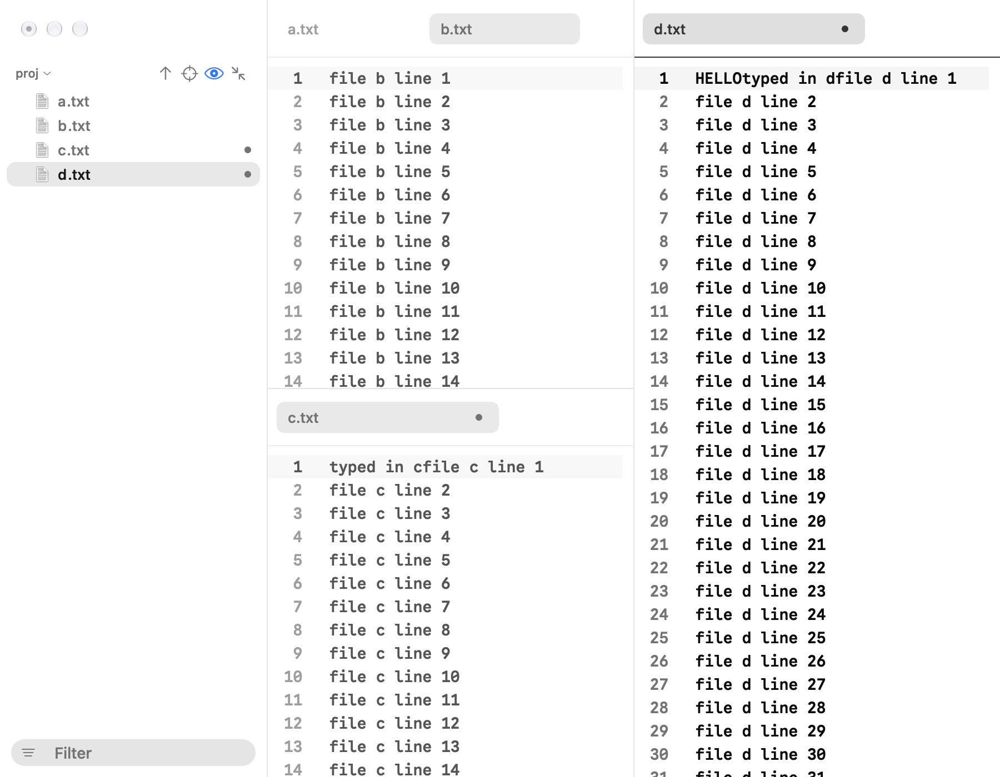

# Finch

Finch is a small, fast text editor for the Mac, written in Rust on [GPUI](https://github.com/zed-industries/zed/tree/main/crates/gpui). It opens files in tabs with a folder tree on the left and a Markdown preview on the right, and it keeps every Untitled page as a draft so nothing you type is lost.



Finch is young (it started in October 2026) and built for one person's daily writing and coding. Expect rough edges on setups it hasn't met yet.

## What it does

- Code coloring for about 35 languages through tree-sitter, picked from the file name, a `#!` line or a modeline.
- A folder tree with git status, sorting, a filter, file actions with undo, and Open quickly (Shift-Cmd-O) for any file by name.
- Split panes, pinned tabs, Find and Replace with regex and Ignore diacritics, Find in folder, Go to line and Go to symbol.
- A live Markdown preview with GFM tables, callouts, math, diagrams, footnotes and note links (`[[...]]`).
- Untitled pages kept as drafts, saved versions of every file with a side-by-side Compare view, and a scratch window.
- Spelling, a style check, smart punctuation, typewriter scrolling, a reading column and a Minimal mode.

The full user guide is in [docs/guide](docs/guide/index.md). In the app, Finch Help (Cmd-?) opens it.

## Requirements

- A Mac with Apple Silicon. Intel Macs aren't supported.
- Rust (edition 2024; Finch is built with a current stable toolchain).
- Xcode with the Metal toolchain, since the GPU shaders are compiled at build time. If `xcrun -f metal` fails, run `xcodebuild -downloadComponent MetalToolchain`.

## Build and run

```sh
cargo run --release -- path/to/file.md
```

To make an app bundle you can put in /Applications:

```sh
scripts/bundle.sh
```

The bundle is signed with the identity in `FINCH_SIGN_IDENTITY`, or the first line of `~/.config/finch/sign-identity`, and ad hoc when neither is set. An ad hoc build runs on the Mac that built it.

Tests run with `cargo test`.

## Settings

Settings live in `~/Library/Application Support/Finch/settings.toml`, and the Settings window (Cmd-,) edits the same file. The default editor font is Google Sans Code NF at 14 points. When that font isn't installed, code draws in the Mac's monospaced font instead; any installed monospaced family can be picked under Settings > Editor.

## Layout

- `src/`: the app.
- `vendor/`: GPUI, GPUI Kit, markdown-rs and two small crates, vendored with local changes. Each folder's `PATCHED.md` lists what changed and why.
- `docs/guide/`: the user guide, bundled into the app.
- `docs/design/system.md`: every size, color and motion length the views use, generated from `src/tokens.rs` by `scripts/tokens.sh`.
- `scripts/`: building, bundling, and launching test windows in the background.

Comments and commit messages cite tickets like `finch#abcd`. They point to the project's private tracker.

## License

Finch is licensed under the [Apache License 2.0](LICENSE). The vendored code keeps its own licenses (Apache 2.0 and MIT); see [NOTICE](NOTICE).
