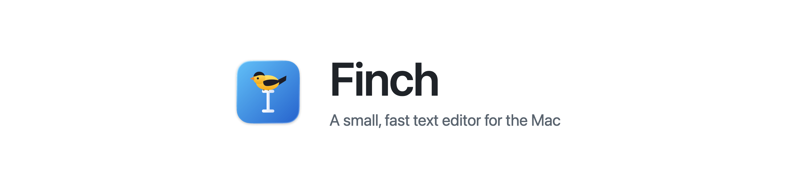
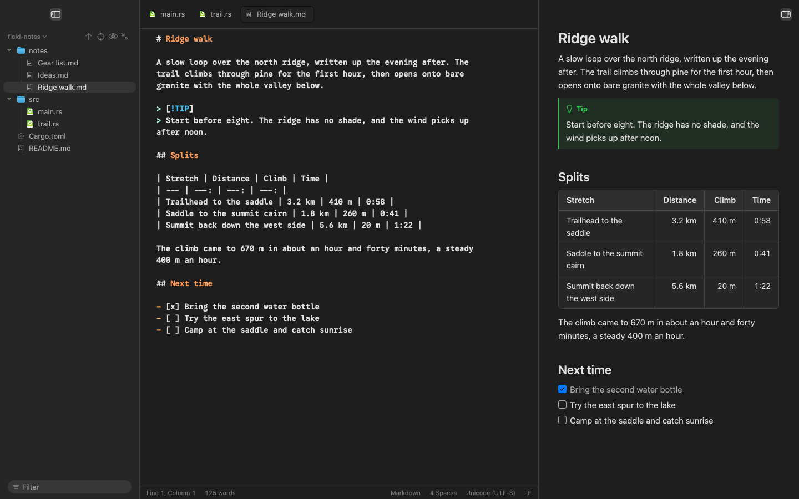
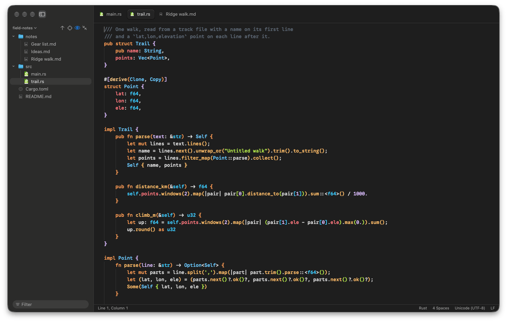

<p align="center">
  <picture>
    <source media="(prefers-color-scheme: dark)" srcset="docs/assets/readme-header-dark.png">
    <source media="(prefers-color-scheme: light)" srcset="docs/assets/readme-header-light.png">
    
  </picture>
</p>

Finch is a small, fast text editor for the Mac, written in Rust on [GPUI](https://github.com/zed-industries/zed/tree/main/crates/gpui). It opens files in tabs with a folder tree on the left and a live Markdown preview on the right, and it keeps every Untitled page as a draft on disk, so nothing you type is lost.

<picture>
  <source media="(prefers-color-scheme: dark)" srcset="docs/assets/readme-dark.png">
  <source media="(prefers-color-scheme: light)" srcset="docs/assets/readme-light.png">
  
</picture>

Finch is young (it started in October 2026) and built for one person's daily writing and coding. Expect rough edges on setups it hasn't met yet.

## What it does

### Writing

- A live Markdown preview beside the text, with GFM tables, task lists, callouts, footnotes, math, Mermaid diagrams and note links (`[[...]]`). It scrolls with the editor and can export to HTML.
- Spelling, a style check, smart punctuation and a writing goal with a progress line under the text.
- Typewriter scrolling, a reading column, a Focus mode that dims everything but the sentence, line or paragraph you're in, and a Minimal mode that hides everything but the text.
- Templates for new pages, pasted and dropped images saved next to the note, and reading aloud.

### Code

<picture>
  <source media="(prefers-color-scheme: dark)" srcset="docs/assets/readme-code-dark.png">
  <source media="(prefers-color-scheme: light)" srcset="docs/assets/readme-code-light.png">
  
</picture>

- Code colors for 34 languages through tree-sitter, picked from the file name, a `#!` line or a modeline, with a choice of color schemes and rainbow brackets.
- Find and Replace with regex and Ignore diacritics, Find in folder, Go to line and Go to symbol.
- Multiple cursors, git change bars in the gutter, folding, color swatches for color values, and checks that flag a JSON, TOML or YAML file that stops parsing.
- A log file that keeps growing keeps its last line in view.

### Files and tabs

- A folder tree with git status, sorting, a filter, drag and drop, and file actions (new, rename, duplicate, move, trash) that Undo takes back.
- Open quickly finds any file under the folder by name.
- Tabs that fit their names, pinned tabs, a list of every tab when they don't fit, and panes split right or down.
- A scratch window that drops down from the top of the screen from any app (Control-Option-Space).

### Your text is kept

- Every Untitled page is a file in `~/Documents/Scrap Drafts`, written half a second after you stop typing, so a quit or a crash keeps it.
- Each save keeps a copy of the file. Browse the copies and compare any of them with your text side by side, then take the lines you want.
- An Undo history slider scrubs back through the session's edits.
- When a file changes on disk under your edits, Finch says so and lets you compare before anything is replaced.

The full user guide is in [docs/guide](docs/guide/index.md). In the app, Finch Help (Cmd-?) opens it.

## Speed

Finch draws its own window with the GPU, the way Zed does. Release builds on an M-series Mac draw the first frame 0.35 to 0.6 seconds after the process starts, for a 2-line file and a 50,000-line file alike. Scrolling a million-line file keeps the same frame pacing as a short one, and long lines wrap a slice at a time, so a big file never stalls the window.

## Keys

| Keys | What it does |
| --- | --- |
| Cmd-T or Cmd-N | New tab |
| Cmd-W | Close tab |
| Shift-Cmd-T | Reopen closed tab |
| Cmd-1 to Cmd-9 | Show a tab |
| Shift-Cmd-O | Open quickly |
| Option-Cmd-O | Open a draft |
| Cmd-F / Shift-Cmd-F | Find / Find and replace |
| Shift-Option-Cmd-F | Find in folder |
| Cmd-L / Control-Cmd-J | Go to line / Go to symbol |
| Cmd-D | Select the next match |
| Cmd-B | Show or hide the folder tree |
| Shift-Cmd-V | Show or hide the Markdown preview |
| Cmd-\ / Shift-Cmd-\ | Split right / Split down |
| Control-Cmd-Return | Minimal mode |
| Control-Option-Space | Scratch window, from any app |
| Cmd-, | Settings |

## Build and install

You need:

- A Mac with Apple Silicon running macOS 14 (Sonoma) or later. Intel Macs aren't supported.
- Rust (edition 2024; Finch is built with a current stable toolchain).
- Xcode with the Metal toolchain, since the GPU shaders are compiled at build time. If `xcrun -f metal` fails, run `xcodebuild -downloadComponent MetalToolchain`.

Run it from the source folder:

```sh
cargo run --release -- path/to/file.md
```

Or make an app bundle you can put in /Applications:

```sh
scripts/bundle.sh
```

It builds a release and writes `target/release/Finch.app`. The bundle is signed with the identity in `FINCH_SIGN_IDENTITY`, or the first line of `~/.config/finch/sign-identity`, and ad hoc when neither is set. An ad hoc build runs on the Mac that built it.

To make a disk image for a release download:

```sh
scripts/dmg.sh
```

It writes `target/release/Finch-<version>.dmg` (about 13 MB), with the app beside a shortcut to Applications. The app in it is signed ad hoc unless `FINCH_SIGN_IDENTITY` names a certificate, and it isn't notarized, so on another Mac the first open is blocked: open it from System Settings > Privacy & Security > Open Anyway.

There are no prebuilt downloads yet.

## Settings and files

- Settings live in `~/Library/Application Support/Finch/settings.toml`, and the Settings window (Cmd-,) edits the same file.
- Drafts of Untitled pages live in `~/Documents/Scrap Drafts`.
- Saved copies of your files live in `~/Library/Application Support/Finch/Versions`.

The default editor font is Google Sans Code NF at 14 points. When that font isn't installed, code draws in the Mac's monospaced font instead; any installed monospaced family can be picked under Settings > Editor.

## Layout

- `src/`: the app.
- `vendor/`: GPUI, GPUI Kit, markdown-rs and two small crates, vendored with local changes. Each folder's `PATCHED.md` lists what changed and why.
- `docs/guide/`: the user guide, bundled into the app.
- `docs/design/system.md`: every size, color and motion length the views use, generated from `src/tokens.rs` by `scripts/tokens.sh`.
- `scripts/`: building, bundling, and launching test windows in the background.

Tests run with `cargo test`. Comments and commit messages cite tickets like `finch#abcd`. They point to the project's private tracker.

## License

Finch is licensed under the [Apache License 2.0](LICENSE). The vendored code keeps its own licenses (Apache 2.0 and MIT); see [NOTICE](NOTICE).
