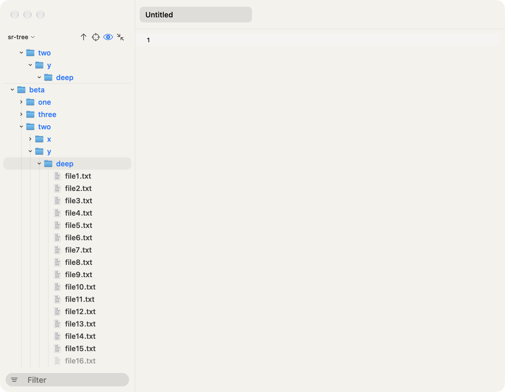

The explorer is a folder tree down the left side of the window. It lists the
folder you're working in, so you can find a file and open it without leaving
the editor.

## What it shows

The panel has no background of its own: it shows the Mac's sidebar look, and the window's three buttons sit over its top, with the explorer button beside them (it shows or hides the panel, like Command-B; it stays put when the panel is hidden). Just below them, the panel names the folder the tree starts from. Under it, that
folder's files and folders are listed, with folders first and files after
them. Both groups are in the order Finder uses: capital and small letters
sort together, accents don't matter (`école` sits with the `e` names, and
`Ångström` with the `a` names), and numbers sort by their value, so `file2`
comes before `file10`.

To sort another way, pick View > Sort by, or Sort by at the bottom of the
pull-down under the folder's name: **Name** (the order above), **Kind** (files
grouped by their extension, so the `.md` files sit together), **Date modified**
(the newest first) or **Size** (the largest first). Folders stay above files
in every order; they sort by name under Kind and Size, and by date under Date
modified. Each window keeps its own order, and a new window starts with the
last one you picked. With Date modified, a file you save moves to the top of
its folder. The filter's list stays in name order.

A folder shows a small arrow. Click it, or select it and press Right Arrow or Command-Down Arrow, to open
or close it. A folder's contents are read the moment you open it, so a very
large folder never slows the window down. An open folder with nothing in it
says "Empty" in its place. When the tree's own folder has nothing in it, the
panel shows "No files" in the middle, with a folder symbol, a line about
dropping files there and a **New file** button that makes a file and opens its
name for typing (the message fades in when the folder becomes empty); Reveal current file and Collapse all folders are dimmed.

Option-click on a folder does what Option-Right and Option-Left do, as in Finder: a shut folder opens along with every folder inside it (up to 500 folders, read in the background), and an open one closes along with everything inside it. Right-click a folder and hold Option to turn Expand and Collapse into Expand all and Collapse all.

The arrow keys move through the tree like Finder's list view. Up and Down step to the row above or below and skip the "Empty" and "Loading…" lines; the first Down with nothing selected lands on the first row. Right opens a closed folder and, pressed again, goes to its first row; Left closes an open folder and, pressed again, goes to the folder holding it (on a file it goes there at once). Home and End go to the first and last row, and Page Up and Page Down move a screen at a time. When a key scrolls the selection into view from above, it stops just under the pinned folder names, never behind them. Option-Right opens the selected folder and every folder inside it, except folders your `.gitignore` rules out (such as `node_modules` or `target`); the folders are read a level at a time in the background, so a big tree opens as it is read, and one press stops after 500 folders. Option-Left closes the folder and everything inside it.

Shift-Cmd-E (View, Focus explorer) puts the keyboard in the tree, showing the explorer first when it is hidden, so you can move with the arrow keys without the mouse. Escape in the tree (with no name being edited) gives the keyboard back to the editor.

With the tree focused, type a name's first letters to jump to it, as in Finder: "re" selects the next row whose name starts with "re", ignoring capitals, looking from the selected row down and wrapping to the top. Letters typed within a second of each other add up; after a pause the next letter starts over. A single letter pressed again steps to the next name with it, and a longer prefix stays on the selected row while it still fits. The row glides into view like any other jump. Space, Return, the arrows and the Command and Option shortcuts keep their meanings, and typing in the filter or in a name field is theirs.

A folder the Mac won't let Finch read (its permissions, or a protected folder such as Desktop or Documents before you've allowed it) says "Can’t read this folder" in place of "Empty". When the tree's own folder can't be read, the middle of the panel says "Finch can’t read “name”." and has no New file button; when it was deleted, it says it isn’t there anymore. New file and New folder never make a deleted tree folder again: they say "The folder “name” isn’t there anymore." (A name typed with slashes still makes the folders on the way.)

Some things are left out on purpose:

- the `.git` folder and `.DS_Store` files
- anything your `.gitignore` files rule out, such as a `target` or
  `node_modules` folder, unless Show ignored files is on (below). Those
  folders aren't read until you open them, so a project with a huge one
  still opens at once.

Other files that start with a dot, such as `.gitignore`, are shown, unless you
turn off Show hidden files in the header.

To open build output or an ignored `.env` file from the tree, turn on View >
Show ignored files (also in the right-click menu of the tree's empty space and
in Settings > General). The files your `.gitignore` rules out then show among
the others, dimmed like dot files (icon, arrow and name), and so does everything inside an ignored
folder; their tip adds "Hidden by .gitignore" under the path; dot files among them still follow Show hidden files. An ignored folder
is read only when you open it, and Option-Right still skips ignored folders.
The filter, Open quickly and Find in folder keep leaving ignored files out. The
choice is remembered; it's off when the app starts for the first time.

A file with unsaved changes shows a small dot after its name.

## Git colours

In a folder that is a git repository, a file's icon takes a colour when git
sees it changed; the name stays plain gray:

- yellow: changed since the last commit
- green: new, whether git already tracks it or not
- red: deleted (the file is gone, so you see this on its folder)
- purple: in conflict after a merge

A folder icon takes the colour of the strongest status inside it, in the order
purple, red, yellow, green, so a collapsed folder still tells you something
changed in it. The icon keeps its shape and shading and wears the colour, so
a changed Swift file is still a Swift file. Files and folders
git doesn't mention keep their usual icons, and outside a repository
nothing changes. The colours are softer in the dark look and deeper in the
light look.

The colours follow your work: after you save, commit, stage or switch
branches they update within a moment. Files that `.gitignore` rules out never
show in the tree, so they have no colour. An icon whose colour changes eases
into it over a fraction of a second; the first read when a folder opens just
sets the colours.

## Preview tabs

A single click on a file opens it as the pane's preview tab, drawn in italics. Click another file and it takes the preview tab's place instead of adding a tab, so browsing leaves one tab behind, not twenty. The tab becomes a normal one when you type in it, double-click the file in the tree, double-click the tab or drag the tab. A preview with edits is never replaced. A file that is already open in a tab just comes forward, and a preview stays a preview. Return, Open and Open to the side open normal tabs. A preview tab isn't remembered for the next launch.

## Icons

Files and folders show the same icons Finder shows for them, so a Swift file, a
PDF or a folder looks as it does on your desktop. Finder draws Markdown, JSON,
settings (`.toml`, `.ini`, `.cfg`, `.conf`), lock and plain text files as one
plain page, so those wear their own gray symbols instead: a rich page, curly
braces, a gear, a box and a text page; dotfiles and files with no extension
wear the text page. Finder has one folder icon,
so a folder looks the same open or closed; the arrow in front of it tells
which. Names are plain gray, folders and files alike, and a file's colour is
on its icon alone (see Git colours). The selected row's name brightens to
white as the wash glides in, and dims back as it leaves. Files that start with
a dot, such as `.gitignore`, are dimmed: a fainter icon, folder arrow and name.

## How it looks

Rows are compact, with the name at 13 points, a folder arrow, an icon, and a
soft rounded wash behind the selected row instead of an outline. Each level of
folders steps in by one icon's width, so a folder's contents have their arrows
under its icon, and a thin line runs down under every open folder; the line of
the folder holding the selected row is brighter, and it parts around the wash
as the wash glides. The wash is one shape, so when you click or arrow to
another row it glides there, and it rides along when you scroll. Moving the
pointer over the tree lights the row under it with a fainter wash that follows
the pointer from row to row. When the tree has the keyboard (after you click in
it) the selected row's wash is brighter than when the editor does. Once
everything stops moving, the tree draws nothing more.

The tree follows the file in front: bring another tab forward and its row is
selected, gliding in if it was out of view. **Save As** on a page that was never
saved does the same for the new file: its row arrives a moment later, when the
tree reads the folder, and the tree selects it then. Picking something yourself
(a click in the tree, or another tab) before the row shows lets that go.

Scrolling the tree by hand shows a slim rounded scrollbar at its right edge. It
fades out half a second after you stop, and a reveal or a jump never shows it.
Rows fade out toward the bottom edge while more are below, and toward the top
once you have scrolled down (under the pinned folder names, when there are any), so the last row never ends in a hard cut.

Folders fold open and shut: the arrow turns a quarter turn while the folder's
rows slide out from under it, and the rows below slide down with them. Click
again halfway and it turns around from where it is. A folder that takes more
than a fifth of a second to read shows "Loading…" and opens when its rows
arrive; a quick one never flashes it. Folders that come back open when you
launch the app, or that open to reveal a file or to show filter matches, are
simply there, with no motion.

A file name too long for the panel is cut in its stem, keeping its start, its last
two letters and the extension (`caret_l…er.rs`), so you still see `.swift` or
`.md`. Tab titles are cut the same way. Rest the pointer on
a row for half a second to see its full path (with ~ for your home folder, as on a tab).

## Filter by name

The field at the bottom of the explorer narrows the tree to the names that
match. Press Cmd-Option-F (or choose Filter explorer in the View menu) to
jump to it, even when the explorer is hidden, then type. Every folder that
holds a match opens, and the letters you typed show in bold over names that
are one step dimmer. Matching is loose: `row` finds `row.rs`, and also
`markdown.rs`, because r, o and w appear in that order. Capital and small
letters count the same, and the search covers the whole folder, including
folders you haven't opened, but skips what the tree leaves out (`.git`,
`.DS_Store` and ignored files).

A long name keeps the first run of matched letters in view while the filter is
on. The name is cut as usual, in its stem with the extension kept, unless the
match sits past that cut: then the start goes instead, with a "…" in front, and
the end of the name stays when it fits ("…eded-drafts-2025"). Else the name keeps
its start and the match with one cut after the match ("other-draft-of-the….md"),
and only when that doesn't fit either does the name cut at both ends.

A name's cut never ends in letters that only repeat the extension: "tokens_and_counters.rs" cuts to "tokens_and_count…ers.rs", not "…rs.rs", which would read as two extensions.

A short query on a huge folder (one letter in 100,000 files) shows the first 1,500 matches in the order the folder lists them, with the folders above them, and a dim note under the last row says how many of the matches show: "1,500 of 80,214 shown". The note isn't a row you can select; Return still opens the first matching file, and a longer query shows every match again once it fits.

Down moves from the field into the matches, and Return in the field opens the
first matching file. If nothing matches, the tree says so, repeats what you
typed and offers a Clear filter button (with the Escape key's symbol beside
it); it does what the clear button does. Escape (or deleting the text) clears
the field and brings the tree back as it was: the same folders open and the
same row selected. While the field holds text, a small clear button at its
right end (Clear filter) does the same and keeps the cursor in the field.

## The header

The folder's name at the top of the panel is a menu. Click it to see the folder
and every folder above it, up to the top of your disk, each with the icon
Finder gives it; pick one to start the tree there. Rest the pointer on the name
to see the full path. The folder you pick is remembered, and the next time you
start the app with no folder given, the tree starts there. Under a line, **Sort
by** opens the four orders, with a check on this window's (see [What it
shows](#what-it-shows)).

Four small buttons sit to the right of the name. Rest the pointer on one to
see what it does and its keys:

- **Enclosing folder** (Command-Up) starts the tree at the folder above the
  current one, with the folder you left selected. It is dimmed at the top of
  your disk.
- **Reveal current file** (Shift-Command-J) opens the folders down to the file
  in the editor and selects it. Shut folders fold open together, the rows
  below sliding down while the view glides to the file; a second reveal while
  they fold turns them around from where they are drawn. A row already in view stays put and its
  highlight flashes; one out of view glides in and lands 24 points from the
  edge it came in from. Scrolling the tree with the wheel or trackpad stops
  the glide. A file outside the tree's folder starts the tree at that file's
  git root (else its folder), the way opening it from Finder would, and shows
  it there; a file whose folder can't be read beeps. Right-click a tab >
  Reveal in explorer does the same.

  You rarely need the key: switching tabs or panes does the same for the file
  you switch to, opening its folders and scrolling only when its row is out of
  view. Files the tree doesn't show (hidden ones, and ignored ones while Show
  ignored files is off), files outside the tree's folder and Untitled drafts
  are left alone.
- **Show hidden files** (Shift-Command-Period) shows or hides files that start
  with a dot. Its eye is open while they show, which is how the app starts,
  and it tints in the accent while the window is in front; it greys with the
  other header buttons when the window is not. Hidden
  or not, `.git`, `.DS_Store` and what your `.gitignore` rules out stay out.
  The choice is remembered. The header button's tip says the state, "Hidden files:
  shown" or "Hidden files: hidden", and its eye is open while they show.
- **Collapse all folders** (Option-Command-Left while the tree has the keyboard; in the text that key folds) closes every open folder.

The same four commands are in the View menu. Command-Up works while the tree
has the keyboard; in the editor it keeps moving to the start of the text.

## Right-click menus

Right-click a row and it is selected at once, then the Mac's own menu opens,
in the window's light or dark look. Items that can't run are left out, never
greyed. Right-click one of several picked rows and they stay picked; see
[Pick several rows](#pick-several-rows).

On a file:

- **Open** opens it in the editor (Command-Down Arrow does the same).
- **Open with** lists the apps that open this kind of file, the one Finder
  uses first and marked "(default)", each with its icon.
- **Quick Look** shows Mac's preview of the file (Space does the same; Space
  again closes it).
- **Show in Finder** (Option-Command-R) selects the file in a Finder window.
- **Copy path** puts the file's full path on the clipboard. Hold Option and
  it becomes **Copy relative path**, the path from the tree's folder.

On a folder, **Open** is **Expand** or **Collapse**, there is no Open with, and
one more item follows a line: **Show “name” as root**, which starts the tree at
that folder.

Right-click the empty space under the rows and the menu is about the tree's
folder: **Show in Finder**, **Copy path** (Option for **Copy relative path**,
which is a dot here), then **Enclosing folder** (left out at the top of your
disk), **Collapse all folders**, **Show hidden files**, which has a check
mark while hidden files show, and **Show ignored files**, with a check mark
while ignored files show.

## Pick several rows

Command-click rows to pick more than one, as in Finder: each click adds a row,
and Command-clicking a picked row takes it out. Shift-click picks every row from
the one you clicked last down (or up) to this one. Picking opens nothing. Each
picked row wears the selection's wash and its name stays bright.

With the tree focused, **Shift-Down Arrow** and **Shift-Up Arrow** grow the
picked run one row at a time, as in Finder's list: the row you started from is the
anchor and stays picked, the far end moves, and the highlighted row follows the far
end and scrolls into view. Shift the other way shrinks the run back to the anchor,
and on past it picks the rows on its other side. **Command-A** picks every row
showing (the rows of a shut folder are not showing, so they are left out). Command-A
in the editor still selects text, and in the filter or a name being typed it
selects that text.

With several rows picked, **Open** (Command-Down Arrow), **Show in Finder**
(Option-Command-R), **Copy path** (Control-Command-C), **Move to Trash**
(Command-Delete), **Duplicate** (Command-D), **Copy** (Command-C) and dragging act
on all of them, and a right-click on one of them shows just those items plus
**Move to…**. Open opens every picked file as a tab and expands every shut
folder (it never opens a folder as a file, and a folder that is open stays open).
Show in Finder reveals all of them in one Finder window. Copy path puts one path
to a line (Option swaps in **Copy relative path**, the same way). Trash asks
once, only if an open tab among them has unsaved edits, and an item inside a
picked folder goes with the folder. Command-Z takes the items back one at a time.
Return still renames the row the highlight is on.

A plain click, an arrow key without Shift or anything else that moves the selection
lets the picks go.

## Make, rename, copy and trash files

These are in the row menu, with their keys shown, and the empty space's menu has the first two for the tree's folder.

- **New file** and **New folder** make the item in the folder you picked (for a file, the folder it is in), named `untitled.txt` or `untitled folder`, and open its name in the row for typing; the rows below slide down to make room instead of jumping. The name without its extension is selected. An extension you type is kept (`idea.md` stays `idea.md`), and a name with no dot stays as typed. A new file opens in a tab once it is named. Type a path like `notes/2026/idea.md` and the folders on the way are made too; end the name with `/` to make a folder instead. A name with `..` or an empty part is refused.
- **Rename** (Return on a selected row) edits the name in the row: a light field inside the row's wash, with the name's letters where they were, and the same focus ring as the filter. Return keeps it and Escape leaves the name as it was. A name that is taken, empty or has a slash or colon shows the reason on a small floating card under the field (above it when the row is near the bottom of the window), after a warning sign, rings the field in red and keeps it open. The row being renamed shows no path tooltip. Clicking away keeps a good name. A file that is open in a tab keeps its tab through a rename, with your unsaved edits; nothing is saved or reloaded. Tabs of files inside a renamed folder follow it too. A new or renamed row out of view glides into view; one already in view stays put.
- **File, Rename…, Duplicate and Move to…** do the same for the file in front, with no row needed, so they work for a file the tree doesn't show too (see Save in the editor guide).
- **File > New file in explorer** and **New folder in explorer** make the item from the editor too, with no row or tree focus needed: the explorer slides in if it is hidden (leaving Minimal mode), and the same name field opens in the folder of the file in front (the tree's folder when that file isn't under it, or the tab is an Untitled page). While it slides in the editor stops taking keys, and the field opens once the slide has landed. The item is made at once as `untitled.txt` (or `untitled folder`): Return keeps the name you typed, Escape leaves it as `untitled.txt` (Command-Z in the tree removes it). They are grey in the scratch window, which has no tree, and have no keys of their own (Option-Command-N stays the tree's).
- With the tree focused, **Option-Command-N** makes a new file and **Shift-Option-Command-N** a new folder (in the selected folder, the folder of a selected file, or the tree's folder when nothing is selected), **Control-Command-C** copies the selected row's path and **Control-Option-Command-C** its path relative to the tree's folder. The row menu shows them. They work only in the tree, so Shift-Option-Command-C (File, Copy path) and the Finder keys are untouched.
- **Duplicate** (Command-D) makes `name copy.ext` next to it, or `name copy 2.ext` when that is taken. A big folder is cloned in one step on APFS (else copied file by file) in the background, so the window keeps answering; the copy shows in the tree when it is done, washing in and opening out of a gap like a pasted file. Dragging a copy in works the same way. A copy that is still running after a quarter of a second makes the name of the row being copied breathe between its resting and lit ink, and the name settles back to rest when the copy lands; a quick copy shows nothing. Paste and drag-in do the same.
- **Copy** and **Paste** (Command-C and Command-V with the tree focused, or the row menu) copy files the way Finder does. Copy puts the selected row's file or folder on the Mac's clipboard, so Finder pastes it too, and a text field pastes its path; the selection flashes once to show it took. Paste copies the files on the clipboard (from the tree or from Finder) into the selected folder, the folder of a selected file, or the tree's folder when nothing is selected. A file whose name is taken there comes in as `name copy.ext`, then `name copy 2.ext`; nothing is overwritten. The new rows wash in like any file that arrives, the first one pasted is selected, and Command-Z removes them. Pasting a folder onto itself, or into a folder inside it, copies it beside the original as `name copy`, as Finder does. In the editor and in the fields Command-C and Command-V stay text copy and paste. Dropping files from Finder names a clash `name 2` instead.
- **Move item here** (Edit menu, hold Option over Paste, or Option-Command-V; also Option over Paste in the row menu or the empty space's menu) is Finder's own: it moves the files on the clipboard into the same folder Paste would use, instead of copying them, the way a drag moves them. From the Edit menu or the key, that folder is the folder of the tree's selected row (the tree follows the file in front), else the tree's folder. A name taken there is refused with an alert and nothing is replaced, open tabs of a moved file follow it, and Command-Z puts each file back. It does nothing while a name or the filter is being typed, and is dimmed when the clipboard holds no files and in the scratch window.
- **Move to…** asks for a folder and moves the row there, with its open tabs following. A folder in the tree works like a drop on it; a folder outside the tree takes the row out of it. Command-Z moves it back.
- **Move to Trash** (Command-Delete) uses the Mac's Trash, so Finder's Put Back works. It asks first only if an open tab of that file, or of a file inside that folder, has unsaved edits; Cancel is the default button, so Return keeps the edits. Those tabs close with it. It refuses, saying why, when a tab of that file is still saving, or when an Untitled page open in any window keeps its text in that file or in that folder (close the page first, as the draft list asks). The selection glides to the row that takes its place (the one above when it was the last), without opening it. Rename, Move to… and a drop refuse a file that is still saving in the same way; try again a moment later.
- **Command-Z** with the tree focused takes back the last of these: removes a new item or a copy (to the Trash if you typed into it), renames or moves back, puts a trashed item back where the Trash had it. Several undo one by one.
- **Shift-Command-Z** with the tree focused does the last undone action again: renames or moves it forward, moves the put-back item to the Trash again (asking first, as Move to Trash does, if you edited it since), or brings back the removed new item or copy. A new file action clears what's left to redo, as typing does in the editor.
- **Open to the side** (a file's menu, or Option-click) asks for the file to open beside the current one.

Open, Expand and Collapse are Command-Down Arrow now, since Return renames.

The tree updates in place: only the folder that changed is read again, and open folders stay open.

## Drag files

Drag a row to move it. Drop it on a folder, or on a file to put it in that file's folder, or on the empty space to put it in the tree's folder; hold Option to copy instead. The folder that takes the drop lights up (over the empty space, the whole tree does), easing in and out rather than snapping, and a shut folder opens once the pointer rests on it for a moment. The card that follows the pointer is no wider than a tooltip, and a long name is cut in the middle, keeping its extension. Hold a dragged file near the top or bottom edge of the tree and the tree scrolls, faster the closer you get to the edge; it stops when you move away, reach the end or let go. Files dragged in from Finder are always copied. Nothing is overwritten: a move onto a name that is taken is refused with the reason, a copy takes `name 2`, and a folder can't go into itself or a folder inside it. A moved file that is open keeps its tab and unsaved edits. Command-Z moves it back, or removes the copy. Dropping several files selects the first one that landed, as paste does.

A move (a drop, a rename that sorts the row elsewhere, Command-Z of either) closes the old row's gap the way a trashed row does and opens the new row out of a gap, washing in, while a shut folder it went into folds open. A rename that leaves the row where it was changes only the name. Command-Z or Shift-Command-Z of such a rename flashes the row once, the way a copy flashes the selection.

While Option is held the card wears a small green plus at its corner, as in Finder, fading in and out with the key, so you can see the drop will copy.

Drag a row out of the window onto Finder or another app to hand over a copy of the file. To drop files on a tab bar or a window edge, see [Split panes](panes.md).

## Drop text to make a file

Select text in an editor, then press inside the selection and drag: the selected text comes along on a small card showing its first line. (A press outside the selection still selects, and a click inside it still puts the caret there.) Drop it on a folder, on a file (its folder) or on the empty space, and a new file opens in that folder with its name already being edited. The name is the text's first line, trimmed and made safe for a file name (no `/` or `:`), cut to about 40 characters, with the extension of the file the text came from, else `.txt`; the part before the extension is selected, as in Finder. Return makes the file holding exactly the dragged text and opens it in a tab. Escape cancels and makes nothing.

## Open a file

Click a file, or move to it with the up and down arrow keys and press Command-Down Arrow,
to open it in the editor. The left and right arrow keys close and open the
selected folder.

## Changes outside the editor

The tree follows the folder while you work. When a file or folder is added,
renamed or removed by another app or a command in the terminal, it appears,
changes or disappears in the tree within a moment. Folders you have open stay
open and your selection stays where it is. Changes inside ignored folders such as
`node_modules` are not followed, and neither is the churn inside `.git`; only a
commit, checkout or stage (which change git's index or HEAD) is noticed, to
update the git colours.

A file or folder that turns up this way gets one soft wash behind its row, the
same ink the selection uses at a low strength, fading out in about half a
second. At most four rows wash at once, so a batch of new files shows a few
rows, not a flicker down the tree. Nothing washes for the first time a folder
is read, for a folder you open, while a filter shows, for Show hidden files, or
for a file you made in the app (new, renamed). Copies, dropped copies and a trashed file put back by Command-Z wash and open a gap like any arrival.

The washed rows on screen also open out of a one-row gap, so the rows below
slide down instead of jumping (the same cap, and not for the first row of the
list or when the folder's only row was "Empty"). When the first file arrives in
a tree that said "No files", that message fades out under the new row over
0.15 seconds instead of vanishing.

A row that leaves the tree (removed from outside, or trashed in the app) closes its gap the same way: the row slides up under the one above it and fades while the rows below follow, instead of snapping up. The same cap of four applies. A removal of more rows than that at once (Show hidden files turned off, say), a folder that was open, a rename or a move, and a filter all snap as before.

Editing a `.gitignore` or `.ignore` file updates what the tree hides at once,
in folders you already have open too. A folder reached through a symlink that
points outside the tree's folder refreshes when its files change, just like
the rest; a link that points back inside the tree's folder doesn't refresh on
its own.

An open file that another app changes shows the new text right away, with
your place in it kept. If you've changed that file and not saved yet, your
changes stay and the editor doesn't load the other version.

## Folder names stay at the top

While you scroll inside a deep folder, the names of the open folders that
hold the top row stay pinned at the top of the tree, outermost first, one row
per level. They show how deep you are without scrolling back. The folder you
are in slides up and away as the last row of its contents passes under it, and
the folders around it follow as theirs end.

A pinned name looks like its row in the tree, with the same icon and colour,
on the tree's own background. Point at one and its wash fades in and out like
any row's, while the row under it shows no hover. A soft shadow under the lowest one eases
in as you scroll past the first pin, and the rows sliding under the names fade
out just below them, so no hard line shows.
Click a pinned name to scroll the tree so that folder's row sits right under
the pinned names above it, and select it; the folder stays open. Nothing is
pinned while the top row isn't inside a folder.
