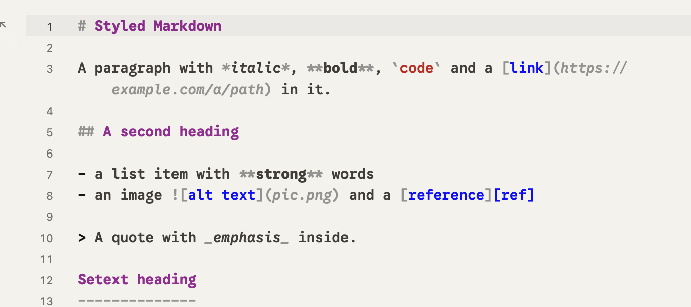

# Styled Markdown

Turn on View > Styled Markdown and a Markdown file reads more like a document while you write it:

- Headings are semibold, in the heading color.
- Bold text shows bold and italic text shows italic.
- The marks around the words fade to a quiet grey: the `#` before a heading, the `**` and `_` around emphasis, the `~~` around struck text, backticks, and the brackets, parentheses and address of a link or image. A `~~` beside spaces on both sides, and a lone `~` or a run of three, stay plain text. The brackets of a reference link such as `[text][ref]` keep the link color.

The line you are editing (the one with the caret) shows its marks back at full strength, so nothing is hidden while you type. Move to another line and the marks there fade again; the line you left fades with it. The full-strength marks are the ones the file has with the option off: the quiet grey for `#` and `**`/`_`, the code color for backticks and the plain text color for link brackets and parentheses, and the link color for addresses. A line over 16 KB keeps its faded marks.

Only the ink changes. Every character keeps its size, font and width, so lines wrap where they always did, the caret moves over each mark as before, and nothing is hidden. Headings stay the same size as the text for the same reason: every row of the editor is one height.

## Turn it on or off

View > Styled Markdown has a check mark while it is on. Click it to turn it on for every Markdown file, in every window; the choice is kept the next time you open Finch. It is off at first, and with it off Markdown looks as it always has. In the settings file it is `styled_markdown` under `[editor]`.

The styling lands about a moment after you type, like the rest of the colors, and very large files (over a few megabytes) keep their plain look.

Other kinds of files are never touched by this option, and the Markdown preview is unchanged.
