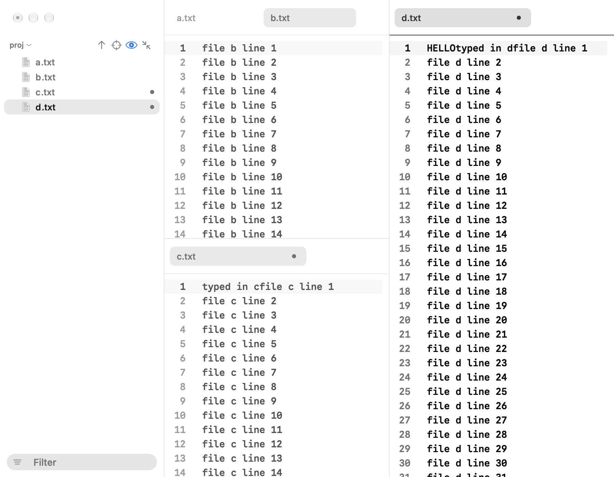

Split the editor to see files side by side or one above the other. Each pane has its own row of tabs.

A pane at the top of the window has the tall band the window's buttons sit in (52 points), and you can drag the window by it. A pane lower down, under a split down, has a compact bar instead: 40 points, with the tab centered in it, and its text starts right below it. The pane's soft line of light and the drop zones follow the bar's height.

## Split

Press Cmd-\ to split the pane you are in to the right, or Cmd-Shift-\ to split it downward. The tab you are looking at moves into the new pane. The same items are in the View menu as Split right and Split down, and in a tab's right-click menu, where they split for the tab you clicked, which comes forward first. A pane with only one tab doesn't split, since it would leave nothing behind, so the items are grey and the keys beep; open a second tab first.

## Move between panes

Click in a pane to work in it. Press Cmd-K, then an arrow key, to move to the pane in that direction. The pane you are in has a soft line of light under its tab bar, brightest in the middle and fading toward both ends (fainter in a light theme, where dark ink reads stronger), and the others are washed out a little, and in any editor that isn't taking your typing (another pane, or the find bar or a filter field holding the keyboard) the highlighted line's band is at half strength and its bright line number is the plain grey; all of it eases over a moment when focus moves, when a split opens a new pane (the light moves over to it) and when a close leaves one pane (the light fades away, since one pane needs none). When the window is not the one you are typing in, the line dims. Only that pane's cursor blinks.

Opening a file, Cmd-N, Cmd-T, Cmd-W and the tab keys all act on that pane. A file that is already open in another pane isn't opened twice: its tab comes forward in the pane that has it. The preview shows the file in the pane you are in, and the window has one preview button, at its top right corner, which shows while that pane's file has a preview and toggles the preview for that pane. Only the top pane at the right edge of the editor leaves room for it in its tab bar; the other panes' bars use their full width.

Cmd-Shift-T reopens the last closed tab in the pane it was closed in, or in the pane you are in when that pane has since closed. Ctrl-Tab goes by use within the pane you are in.

The Window menu has Focus pane left, right, up and down, which do what Cmd-K and an arrow do (the menu can't show that two-key chord, so the items carry no key; Cmd-K then an arrow with Cmd still held works the same), and Move tab to left, right, upper and lower pane, which send the tab you are looking at to the pane in that direction the way dragging it onto that pane's tab bar does: its caret, scroll and unsaved text go with it, and that pane takes the keyboard. A pinned tab arrives pinned, and a pane that gives away its last tab closes. The same four Move items are in a tab's right-click menu, for the tab you clicked. Each item is grey while no pane lies that way, and its key beeps.

Move tab to new window, below them in the Window menu and in a tab's right-click menu, opens the tab in a window of its own the way dragging it off the window onto the desktop does, with its caret, scroll and unsaved text. It is grey while the window holds only that one tab, in one pane.

Focus next pane and Focus previous pane, under the four Focus items, step through the panes in reading order (the top left one first, left to right and top to bottom) and wrap round at the ends. They carry no key, and are grey with one pane.

Window > Even out panes does what a double-click on a divider does to every divider at once: each split glides to even halves, with the same small overshoot, and the new sizes are kept. It is grey with one pane.

Window > Merge panes gathers every pane's tabs into the active pane: the other panes' tabs follow the active pane's own, in reading order and in their own order, pinned tabs stay pinned, and the emptied panes glide shut. Window > Merge all windows does the same across windows: every other window's tabs come into the front window's active pane with their edits and unsaved pages as they are (a tab from another folder comes across as it is), and the emptied windows close. Merge panes is grey with one pane, Merge all windows with one window.

## Dragging

Drag a tab onto another pane's tab bar to move it there. As the pointer comes over that bar, the tabs ease apart to open an empty gap where the tab will land, and the gap glides between the tabs as you move; move off the bar and it folds shut. Let go and the tab fills the gap and comes forward in that pane. Dragging a tab along its own bar still reorders it.

A pinned tab dragged to another pane lands pinned there, at the end of that pane's pins, which is where its gap opens. One moved by Split right or Split down lands the same way. Dropping an unpinned tab never puts it among the pins.

Drag a tab over a pane and its edges light up: a quarter of the pane on the left, right, top or bottom shows a rounded block in the accent color (the one a folder takes in the tree when you drag over it) where a new pane would open, half the pane on that side. The block fades in as you arrive and glides from zone to zone, and across panes, as you move; the pane's middle shows the whole pane. Let go there and the tab opens in that new pane. Let go on the pane's middle and the tab moves into that pane. When the pane you took the tab from has no tab left, it closes and its neighbor takes the space; a pane's only tab dropped on its own edge stays where it is, since there is nothing to split from.

Drag a tab out of the window and let go over the desktop, outside every Finch window, and it opens in a new window of its own. The window starts as the card you let go of, at its size and place, and grows to its full size over a quarter of a second, ending where you let go with your pointer near its first tab. While you hold the card well away from its bar (more than about 60 points above or below it, or outside the window), the tab's slot in the old bar folds shut behind it, and opens again if you bring the card back near the bar. It is the same page that was in the old window: the caret, the scroll position, the undo history and any unsaved text come with it (an Untitled page keeps its draft), and nothing is read from disk again. The new window has the size you last left a window at and doesn't change what Finch remembers of it beyond what any new window does. Let go over another Finch window instead (on any display) and the tab joins that window: as the pointer comes over that window's tab bar the tabs ease apart to open a gap that follows the pointer and folds when it leaves, and over a bar the tab lands in that gap, anywhere else on the pane it lands at the end of its tabs, and that window comes forward. A window whose last tab leaves closes.

Files work the same way. Drag a file from the folder tree, or from Finder, onto a pane's tab bar to open it as a tab there (the bar opens a gap for it, as for a tab), or onto a pane's edge to open it in a new pane. Dropped on the middle of a pane it opens as a tab in that pane. A file that is already open in another pane brings its tab along instead of opening twice. Folders are ignored, and files dragged from Finder are opened where they are, not copied.

On a Force Touch trackpad you feel a soft tick when a dragged tab (or file) settles over a new tab slot or a new edge zone, when a pane line meets its least size, and when the folder tree's or preview's edge reaches its rest width or its least; a mouse feels nothing.

## Resize and close

Drag the line between two panes to resize them; it stays under the pointer. Double-click the line to even the two panes out: it glides to the middle and passes it by a hair before it settles. A pane never goes narrower than 200 points, so its tab row still shows one whole tab with a readable, shortened title (`n…-3.md`); in a pane that narrow the tabs shrink below their usual width to fit. The one exception is the pane in the window's top left corner while the folder tree is hidden: its tabs start after the traffic lights and the tree button, so it stops 276 points wide, leaving room for one tab. Push the line past the limit and it stretches a little way against your hand (it moves about half as far as the pointer, and no more than 36 points), then springs back when you let go, carrying the speed you let go at. When you close a pane's last tab the pane closes and its neighbor takes the space; the closing pane keeps showing its tabs and text until it is gone. The last pane in the window stays, empty: it shows a document symbol with "No open file", the line "Start a new tab, open a file, or open a draft." and three buttons in the middle, in that order, **New tab** ⌘T, **Open…** ⌘O and **Open draft…** ⌥⌘O (click one or press its keys), and no line under the empty tab bar. In a pane too narrow for both buttons they stack; in one under about 170 points tall the symbol and the line drop and the title and buttons stay. The message fades in each time the pane becomes empty.

## Status line

Every pane with a tab has a slim status line at its foot, under the editor, so a split shows one per pane. The left side says where the caret is, counted from 1: `Line 12, Column 8`, with the size of the selection after it when there is one (`Line 12, Column 8 (42 selected)`). In a Markdown or plain-text file the word count follows (`1,204 words`, or `38 of 1,204 words` while you have text selected); a code file shows none. The right side says the file's language, its indentation (`4 Spaces`, or `Tabs`), its encoding by the name File > Reopen with encoding shows, and its line endings (`LF` or `CRLF`; a file whose breaks were mixed shows `LF`). An empty pane has none.

Five fields can be clicked. The line and column open Go to line, as Cmd-L does. The word count opens a small pop-up with the file's characters, lines and reading time (at about 230 words a minute); its rows are greyed because they only inform, and with a writing goal a fourth row gives the progress. Resting on the word count says the same in a tip (`412 of 500 words, 82%`, or `Goal reached`). The number sum (below) copies the sum. The indentation opens a menu with Convert indentation to spaces and Convert indentation to tabs, the same as in the Edit menu; the row for the style the file already uses is checked and greyed. The encoding opens the choices of File > Reopen with encoding and rereads the file in the one you pick; an Untitled page has no file to reread, so its encoding is plain text. The language and line endings are only shown.

The words are counted a moment (about 0.3 seconds) after you stop typing, so the number holds still while you write and catches up when you pause. A word is anything between spaces that has a letter or a digit in it, so a lone dash or a row of asterisks doesn't count. A file over 4 MB shows no count.

A file with a writing goal (`goal: 500` in its front matter, or Format > Writing goal…; see Writing goal in the main guide) draws its progress along the status line's top edge: a one-pixel line in the accent color that fills from the left as the word count climbs, glows once when the goal is reached and stays green. It sits on the status line's own rule, so it isn't part of the text and costs nothing while you aren't writing.

Select text that holds numbers (a column in a CSV, a log, a config, a list of prices), in any kind of file, and a quiet field after the selection's size adds them up: `Sum 1,284 · avg 160.5 · 8 numbers`. It needs at least two numbers; plain words show nothing. Negatives (`-4`), decimals (`0.5`), thousands commas (`1,284`), a leading currency mark (`$9.99`) and a trailing percent sign count. A number glued into a word (`v2`, `x86`, `3rd`), a range or date (`10-20`, `2024-05-01`) or a version (`1.2.3`) doesn't. A comma counts as a thousands comma only before exactly three digits; in `5,10,15` it separates three numbers. Click the field to copy the sum as a plain number, without commas, ready to paste into a sheet. The field fades to "Copied" for a second, in the same place, so nothing in the strip moves, and fades back; a second click starts the second again. The sum is worked out when the selection changes, never while you type or scroll, and a selection over 1 MB shows none.

With more than one caret (Edit > Add cursor above or below, or Select all matches), a quiet `4 cursors` appears after the position and goes when one caret is left.

In a JSON, TOML or YAML file the strip can say two more things after the position (see Config files in the main guide). When the file stops parsing, an amber note fades in, such as `Line 4: expected a comma`; it shows about a third of a second after you stop typing, a click puts the caret on the spot, and it goes at once when the file parses again. A quiet path shows where the caret is, led by a small outline symbol (three indented lines) so it reads as a place and not a stray word: the symbol, then `server > ports > 1` (a long one keeps its innermost parts: `... > ports > 1`); click it to copy `server.ports[1]`, Option-click to copy a jq filter, `.server.ports[1]`.

A clickable field lifts and takes a wash under the pointer, and says what it does in a tooltip after a short rest (Go to line has its Cmd-L). The text is dimmer in a pane that doesn't have the keyboard and in a window that isn't in front, and eases back when you come to it. When the last tab of a pane closes, the status line fades out with the editor. In a narrow pane the position first reads short (`Ln 12, Col 8`), and then, before it would be cut, whole fields drop out so none is cut mid-letter and a selection's `(22 selected)` stays whole: the path in a config file first, then the number sum, the language, the word count, the cursor count, the line endings, the encoding, the indentation, and the amber parse note last.

## Tab list

While a pane's tabs don't fit, the chevron at the end of its bar opens a list of every tab in the bar's order. Each row has the file's icon (a document symbol for an Untitled page), names that long are cut in the middle and keep their extension, two files with the same name show their folder (`README.md (notes)`), an unsaved one has its dot, and the tab in front is checked. After the name a row says what the tab's tip says: `Pinned`, `Read-only`, `Changed on disk` or `Deleted`. Picking a row brings that tab forward.

Rest the pointer on a tab and its tip shows the file's full path, then a line for each thing that is true of it: `Pinned`, `Unsaved changes`, `Read-only`, `Changed on disk` or `Deleted from disk`. The tip is the top of a peek card that adds the five lines around the file's caret (see [Tabs](index.md)), and the card glides between tabs as you move along the bar. An unselected tab's title brightens as the pointer comes over it, and the selected tab's title dims with its wash when its pane or the window doesn't have the keyboard. The card you lift when you drag a tab carries the tab's own mark, pin, italics and folder, so nothing changes when it lands.

## Preview tab

Each pane has one preview tab: a single click on a file in the folder tree opens it there in italics, and the next single click replaces it (see [Explorer](explorer.md)). Typing in it, double-clicking the tab or dragging it makes it a normal tab. Opening with Cmd-O, from Finder, by drop or on relaunch always makes normal tabs.

## Next launch

Finch remembers how the window was split, the sizes, each pane's tabs and the pane you were in.
